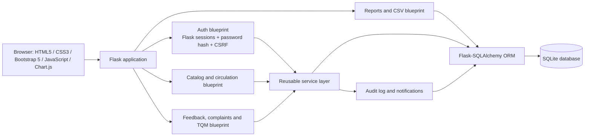

# Application architecture



## Issue / return workflow

```mermaid
sequenceDiagram
  actor Staff as Librarian
  participant UI as Loan screen
  participant Service as Transaction service
  participant DB as SQLite
  participant Member as Member account
  Staff->>UI: Select member and title
  UI->>Service: Validate issue request
  Service->>DB: Begin transaction and verify member, duplicate, copy
  alt Eligible copy found
    Service->>DB: Copy available → loaned; insert loan, audit, due notification
    DB-->>Service: Commit
    Service-->>UI: Confirm issue and due date
  else Invalid / unavailable
    Service->>DB: Roll back
    Service-->>UI: Explain validation failure
  end
  Staff->>UI: Scan/process active loan return
  UI->>Service: Validate active loan
  Service->>DB: Set returned; assess configured fine; release or allocate copy
  alt Waiting member exists
    Service->>DB: Mark reservation ready and notify member
  else No waiting member
    Service->>DB: Copy status → available
  end
  Service->>DB: Write audit record and commit transaction
  Service-->>UI: Confirm return and fine (if any)
```


## Background Data Maintenance & Health Monitoring

1. **System Health Check (`/healthz`):** A lightweight unauthenticated probe endpoint for container orchestration and uptime monitors returning database latency and status.
2. **Temporary Data Purge Service:** Periodic maintenance routine (`services.purge_expired_records`) that automatically cleans up expired password-reset tokens and abandoned catalog import previews while preserving an audited record of removed entries.
3. **Catalog & Database Integrity Diagnostics:** Automated consistency verification tools (`scripts/check_catalog_health.py` and `flask catalog-summary`) that verify relational integrity, detect orphaned copies, check active loan alignment, and audit password hashing security.

