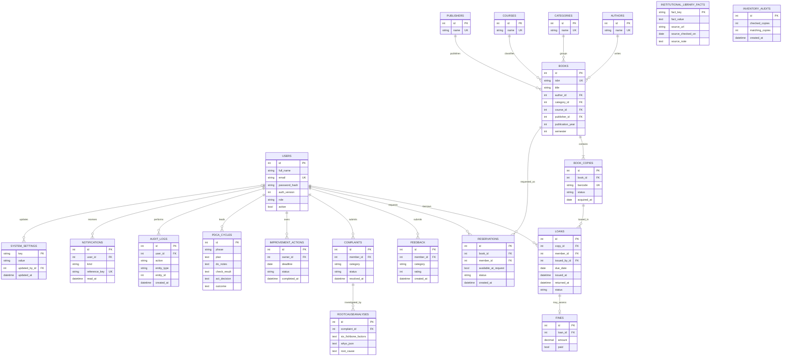

# Database schema

The application uses SQLite through Flask-SQLAlchemy. Foreign keys are enabled on SQLite connections. SQLAlchemy models provide primary keys, foreign keys, unique constraints, status/rating/amount checks, and indexes on lookup and reporting fields. Physical inventory is represented by one `book_copies` row per copy; availability is derived from the status of those rows.

## Entity relationships

## Important consistency rules

- `users.role` is constrained to `admin`, `member`, or `quality_manager`; public registration always creates a `member`.
- ISBNs, emails, copy barcodes, and notification reference keys are unique.
- A partial unique index prevents two active loans for one physical copy. The issue service also checks for another active loan for the same member and title.
- A book's total/available copy count is derived from its copy rows. An active loan changes one copy from `available` to `loaned`; return changes it to `available` or `reserved` for the next waiting member.
- A partial unique index prevents duplicate active reservations for the same member and title.
- Rating, role, status, fine amount, and inventory audit counts have database checks in addition to request validation.
- Issue and return update the loan, copy, fine, reservation, audit, and notification records within one SQLAlchemy transaction. Exceptions roll the transaction back.
- `inventory_audits` holds physical spot-check samples. The accuracy KPI is based on these samples rather than assuming the database is correct.

The schema is initialized with the repeatable `flask --app run.py init-db` command. For an academic local demonstration this uses `create_all`; changes to an already deployed schema should be managed with a migration tool and a backup, not by resetting a database containing user data.
